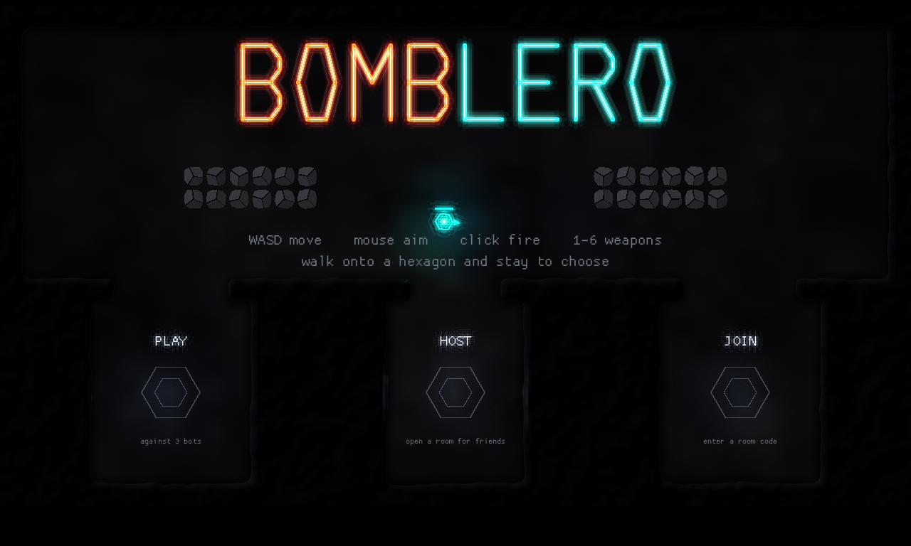
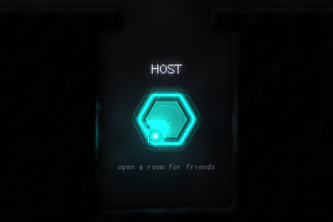
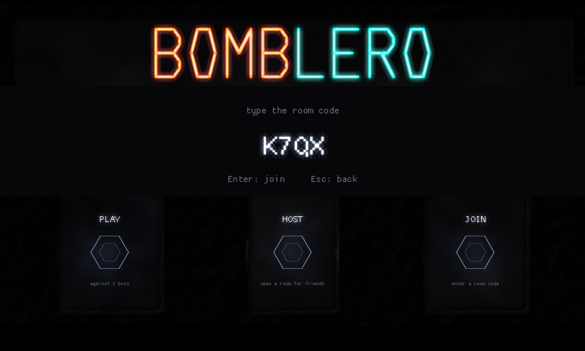
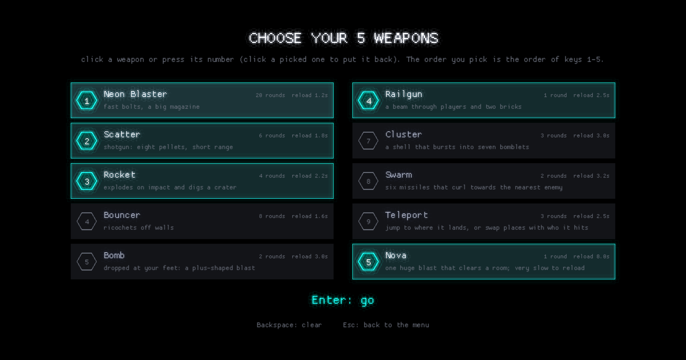
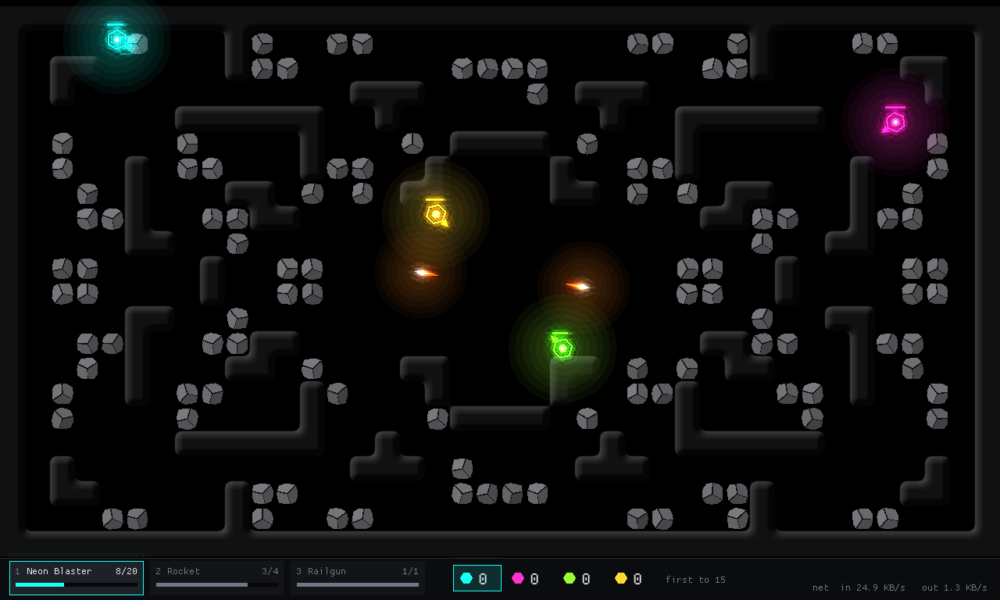
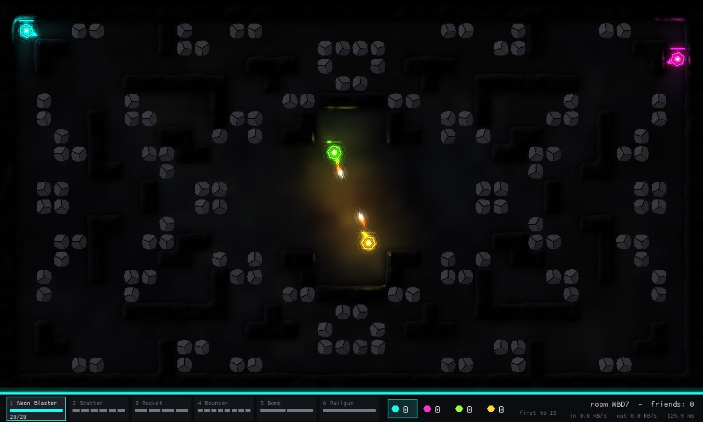
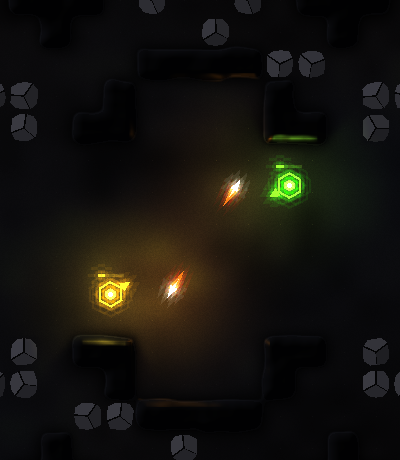
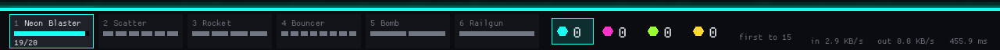

# Bomblero

**Bomblero** is a fast top-down arena shooter in a dark neon cave: blast the
bricks, dodge the bombs, and be the first to 15 kills. It is written in Rust
with [macroquad](https://macroquad.rs), runs in the browser (WASM) and
natively, and you can play it online with friends through a room code. 

It uses **no external assets**: graphics are procedural shapes plus a glow
shader, and sounds will be synthesized in code.

It is also a learning project. The code is commented to teach how online
multiplayer works and where patterns from *Game Programming Patterns* fit, so
reading it should explain how a real-time multiplayer game is put together.



*The menu is a level. Walk onto a hexagon and stay a moment to choose; the
shooting range in the middle is for trying the weapons first.*

| | |
|---|---|
|  |  |
| *Standing on a pad: the ring closes edge by edge in your colour.* | *JOIN asks for the room code.* |



*Before every match you choose five of the ten weapons, like Liero's weapon
menu. The order you pick is the order of keys 1-5.*



*A match against three bots. The pebbles break (one facet per hit); the black
walls do not. Colour says who, orange says danger.*



*Hosting: the room code and the network cost are shown in the strip under the arena.*



*Every player and shot is a light. It casts shadows behind walls and glints
along the polished edges that face it, in its own colour.*



*The HUD is one quiet strip: your health is the line along its top edge, each
weapon shows one segment per round, and the scoreboard marks you with your colour.*

## Status

Early but playable. Done so far:

* Free movement (WASD) with mouse aim, in a destructible tile arena: the
  slate pebbles break (one facet per hit), the polished black walls don't. The map
  mixes L, T and Z walls, brick patches and an open middle.
* Ten weapons as rows of a data table: **Neon Blaster** (fast bolts),
  **Scatter** (shotgun), **Rocket** (explosion that digs a crater), **Bouncer**
  (ricochets off walls), **Bomb** (dropped at your feet, short fuse, goes off
  when an enemy touches it), **Railgun** (instant beam through players, stopped
  by bricks), **Cluster** (a shell that
  bursts into bomblets), **Swarm** (six homing missiles), **Teleport** (jump
  to where it lands, or swap places with whoever it hits) and **Nova** (one
  huge blast that clears a room). Each has a magazine and reloads
  automatically.
* A loadout like Liero's: before each match you pick five of the ten. The host
  checks every choice (five different weapons, accepted once) before it
  touches the match.
* Simple bots, 100 HP, respawning, first to 15 kills.
* Three maps and a match setup (map, 1-3 bots offline, first to 5/10/15/25):
  **Grid**, **Anthill** (solid earth with rock layers: dig your own tunnels) and
  **Pinball** (open, nothing breaks, bumpers and slingshots).
* Plays on phones and tablets: twin-stick touch controls (left thumb moves,
  right thumb aims and fires, tap a weapon card to switch), an on-screen keypad
  for room codes, and a layout that adapts to any screen shape. Small screens
  zoom in and follow your player instead of shrinking the arena.
* Online play with room codes: one player hosts, friends join from their own
  browsers. Joiners see the match smoothed by interpolation, with a ping readout.
* A look of its own: a dark cave of mottled stone with polished black walls,
  crisp coloured actors, colour for *who* and orange for *danger*, and real
  lighting: every player, shot and explosion lights the stone, casts shadows
  behind walls and glints off the walls' edges. Only the brightest things glow.
  A quiet HUD strip under the map shows your health (the line along its top),
  your weapons with one segment per round, the scoreboard (your colour marks
  you) and the room status.
* A menu you play: the start screen is a small arena. Walk onto a hexagon to
  play offline, host or join, and try the weapons on the shooting range first.

Planned (see [PLAN.md](PLAN.md)): synthesized sound and more effects, then a
grapple hook, block building, five more weapons (black hole, digger, chain
lightning, laser sweep, time bubble), three maps and a match flow. Not built yet.

## Play it

**In the browser:** open the GitHub Pages site for this repository. One player
presses **H** and tells the others the 4-letter room code; the others press
**J** and type it. The first load can take about a minute while the free relay
server wakes up. Keep the hosting tab visible, because browsers freeze
background tabs and the match runs inside the host's tab.

**Natively** (needs [Rust](https://rustup.rs)):

```
cargo run -p game --release          # the game
cargo run -p server --release        # the relay, only for online play (port 9001)
cargo test                           # headless tests, no window needed
```

Menu: walk onto the **PLAY**, **HOST** or **JOIN** hexagon and stay a moment
(or press **P**, **H**, **J**). **O** opens a room whose match runs on the
server instead of in your browser (first step of the dedicated server; friends
join it with **J** and the code as usual).

| Key | Action |
|---|---|
| W A S D | move |
| mouse | aim |
| left button | fire |
| 1-5, Q / E, mouse wheel | choose weapon (1-0 on the menu's shooting range) |
| R | restart the match (offline or when hosting) |
| I | (joiner) turn interpolation on or off, to see what it does |
| Esc | back to the menu |

## How it is built

```
sim/        the rules: tilemap, players, weapons, projectiles, bots. A headless
            crate with no window, sound or network; it is only fed inputs.
protocol/   the messages (Input, Snapshot, Event, ...) and the client's Replica
host/       the Host: collects inputs by player, steps the sim, builds snapshots
server/     the relay: rooms by code, forwards opaque bytes, knows no rules
game/       the macroquad client: drawing, input, menu, hosting and joining
docs/       NETWORKING.md and DEPLOY.md
```

The central idea is **inputs in, state out**. Keyboard, bots and network players
all produce the same small `Input` struct, and only the host ever calls
`World::step`. Everyone else draws a copy of the world built from snapshots.
Because of that, offline play, hosting, joining, bots and the unit tests all run
the same code path, and the sim never depends on rendering, sound or sockets.

**"Host is a role, not a place."** Today the host is one player's browser.
Because the `Host` struct touches no window or socket, it could move into a
dedicated server later without changing the clients (see below).

Patterns from *Game Programming Patterns* are named in comments where they are
used: Game Loop (fixed 60 Hz step), Command (`Input`), Type Object (`WeaponDef`),
Flyweight, Event Queue, Double Buffer and Dirty Flag (snapshots and tile
changes), Spatial Partition (the tile grid) and State.

Read more:

| | |
|---|---|
| [docs/NETWORKING.md](docs/NETWORKING.md) | how a key press travels to a friend's screen |
| [docs/DEPLOY.md](docs/DEPLOY.md) | putting the game and the relay online |
| [PLAN.md](PLAN.md) | decisions, weapon list, milestones |
| [CLAUDE.md](CLAUDE.md) | the coding and architecture rules this code follows |

## Why does online play need a server at all?

Short answer: browsers can't accept incoming connections, so two players can't
simply connect to each other.

* **Nobody can connect to you first.** A direct connection needs one side to
  open a connection *to* the other. Home computers sit behind a router (NAT)
  that drops unsolicited incoming connections, and a web page cannot listen on a
  port anyway. Browsers only make *outgoing* connections, and a WebSocket only
  goes to a server.
* **The two browsers must find each other.** Even WebRTC, the browser's real
  peer-to-peer technology, needs a middleman (a *signalling server*) to swap
  addresses and keys before the direct link exists. Often it also needs a STUN
  server to learn your public address, and sometimes a TURN relay, because some
  networks allow no direct path. Then the traffic goes through a server anyway.
* **Room codes are a lookup.** "Type `K7QX` to join" needs something that holds
  the table of codes.

So a server is unavoidable. What it *does* is a choice:

| | Who runs the match | Server's job |
|---|---|---|
| **Today: relay** | one player's browser (the *host*) | create rooms, forward bytes, never decode them |
| **Later: dedicated server** | the server, which links `sim` and `host` | everything; all players are plain clients |

The relay is the simplest middleman, a post office that knows no game rules. It
costs joiners one extra hop (maybe 10-30 ms) and is far simpler than WebRTC,
which would remove the hop but still need a signalling server, fail silently on
some networks, and has thin Rust/WASM support.

Peer-to-peer would not remove the *host* problem either: someone has to be the
authority, or every peer simulates its own copy and they drift apart. That is
why "host is a role, not a place" is an architecture rule here: moving the role
from a browser to a server must not change the clients.

### Should the server run the match?

Probably yes eventually. It is the dedicated-server move that `PLAN.md` keeps
open.

**Gains**

* The hidden-tab freeze disappears (a background browser tab is throttled,
  which today freezes the match for everyone).
* One player's bad wifi no longer hurts everyone.
* Nobody has a built-in latency edge, and joiners get faster, because their
  input goes straight to the match instead of via the relay and then the host.
* Cheating gets harder, and matches can outlive whoever started them.

**Costs**

* It needs a server that never sleeps. Render's free tier sleeps after 15
  minutes idle and takes about a minute to wake, so realistically that means
  Fly at roughly $2 a month. CPU and bandwidth are not the problem: a 4-6
  player match is trivial for Rust, at about 12 KB/s per player.
* The relay becomes a game server: it must decode messages, run the tick loop
  and own the player slots (the code in `game/src/share.rs` and `host/`).
* The hosting player loses their zero-lag advantage, which is fairer; with
  client-side prediction everybody's own movement is instant again.

**How much work.** Less than it sounds, because `Host` already takes decoded
messages and returns snapshots without touching a socket. The work is moving
`Share` and the tick loop into the `server` crate and making "Host a game"
mean "create a room on the server". `sim`, `protocol` and `Replica` stay as
they are.

**Serving the web files too.** The server could also return `index.html` and the
`.wasm`, giving one deployment and no `RELAY_URL` build setting. But on a
sleeping free tier even loading the page would wait a minute, so the static
files stay on GitHub Pages, which is free and always awake.

**Plan:** play the current version with friends first. If the host-tab freeze or
the host's lag bothers you, do the move then.

## Known limits

* The host's browser tab must stay visible, or the match freezes for everyone.
* Joiners see other players about 100 ms late (interpolation). Their own
  movement is predicted, so it feels instant, but their shots start from where
  the host has them, and nothing is rewound for hit detection.
* The native build can only use a relay on `ws://` (no TLS), so a deployed relay
  works with the browser build only.
* The free relay sleeps when idle, and rooms disappear if it restarts.

## License

[MIT](LICENSE).
